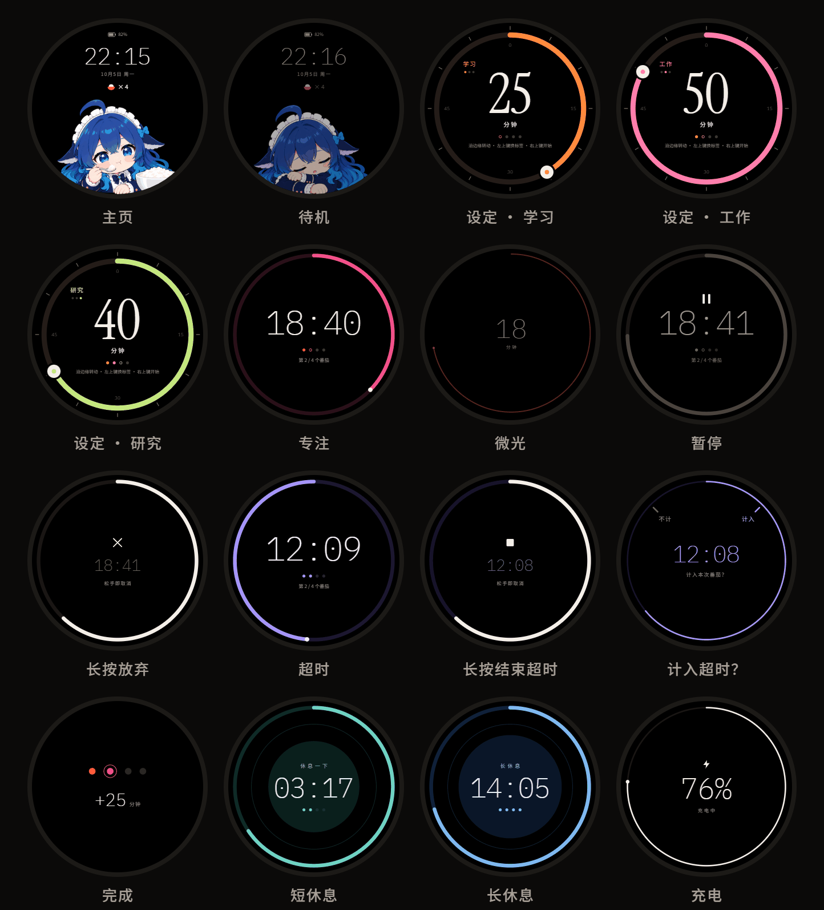

# M5Stack StopWatch 番茄钟

给 [M5Stack StopWatch](https://docs.m5stack.com/)（ESP32-S3，1.75 寸 466×466 圆形 AMOLED）写的番茄钟固件。每完成一个番茄，主页的鲸鱼娘就多吃一碗饭。

> **English summary** — Pomodoro timer firmware for the M5Stack StopWatch (ESP32-S3, 1.75" round AMOLED). Drag along the ring to set 5–60 min, three color-coded tags, overtime tracking with a count / don't-count choice, breathing breaks, battery estimates, and USB sync to CSV. Built with PlatformIO + Arduino + M5Unified / M5GFX. Docs are in Chinese.



<sub>界面总览（重绘的效果图，不是实拍）</sub>

- 沿圆环边缘拖动设时长（5–60 分钟，每 5 分钟一格，每格轻振一下）
- 学习 / 工作 / 研究三个标签，各有颜色，各记各的时长
- 专注 15 秒不碰就进微光，每分钟整体挪几个像素防 AMOLED 烧屏
- 专注中不能直接放弃，要先暂停再长按 2 秒；触摸永远不会触发暂停或放弃
- 时间到不打断你：紫色圆环记超时，结束时选计入还是不计
- 短休息 = 番茄时长的 1/5，跟着呼吸圆放松；一轮 4 个番茄后长休息
- 三档振动，每种振动只对应一个含义
- 电量撑不完这个番茄时，开始前提醒
- USB 同步，每个番茄导出成 CSV

---

## 目录

- [刷机](#刷机)
- [使用说明](#使用说明)
- [工具](#工具)
- [已知问题](#已知问题)

---

## 刷机

只支持 M5Stack StopWatch（C152）。本固件会**替换出厂固件**（启动器和自带应用），建议先备份。

### 准备

装好 [uv](https://docs.astral.sh/uv/)。PlatformIO、esptool、pyserial 都在 `pyproject.toml` 里，第一次执行 `uv run` 时会自动装进项目的虚拟环境（Python 3.12）。下面的命令都在项目根目录执行。

设备**醒着**时电脑上才有它的 USB 串口：深睡眠时串口会消失，先按一下按键叫醒。脚本和上传都会自动找串口；电脑上插着好几块 ESP32 时，脚本用 `--port`、PlatformIO 用 `--upload-port` 指定。

### 1. 备份出厂固件（建议）

```bash
uv run esptool read-flash 0 0x1000000 backup/factory_flash_16MB.bin
```

读出整片 16MB flash，几分钟。备份不进 git（见 [backup/README.md](backup/README.md)）。电脑找不到设备时，按住电源键直到绿灯闪，进入下载模式再试（再单击一次电源键回来）。

### 2. 编译并上传

```bash
uv run pio run -t upload
```

### 3. 校时

```bash
uv run python tools/set_time.py
```

把电脑的时间和时区写进设备。设备时间无效时，主页显示“--:--”和“插上 USB 校时”。之后每次 USB 同步也会顺带校时。

### 恢复出厂固件

```bash
uv run esptool write-flash 0x0 backup/factory_flash_16MB.bin
```

---

## 使用说明

### 按键和触摸

| | 短按 | 长按 |
|---|---|---|
| **右上键**（下文“右键”） | 往前走：开始、暂停、继续、确认、计入 | 画满一圈白色长按环（约 2 秒）后，提前结束当前计时：放弃番茄、结束超时、提前结束休息；在设定界面是重置本轮 |
| **左上键**（下文“左键”） | 设定界面切换标签；超时确认界面选“不计” | 没有作用 |
| **电源键** | 熄屏。没有计时时直接深睡眠；有计时时只关屏，计时和振动照常 | 按住 2 秒关机（进行中的番茄或休息会丢掉） |
| **触摸** | 设定界面沿圆环拖动设时长；点亮屏幕 | — |

- 长按时屏幕上会出现白色长按环，每走 1/4 圈轻振一下，画满时中振确认；中途松手就取消。
- 屏幕处于微光或熄屏时，第一下按键或触摸**只负责点亮**，不执行任何功能。
- 关机时单击电源键开机。固件卡死时按住电源键 4 秒（绿灯闪）进下载模式，可以重新刷机，再单击一次回来。

### 一个番茄的流程

```
主页 →(任意键)→ 设定 →(右键)→ 专注 →(时间到)→ 超时 →(长按右键)→ 计入超时？→ 完成 →(3 秒)→ 休息 → 设定
```

| 界面 | 看到什么 | 能做什么 |
|---|---|---|
| **主页** | 时间、日期、今天完成的番茄数（“× N”碗饭）、电量、吃饭的鲸鱼娘 | 任意键或触摸进设定。30 秒不动进待机 |
| **待机** | 同主页，调暗，鲸鱼娘睡着了 | 任意输入回主页。再 60 秒不动进深睡眠 |
| **设定** | 时长（大数字）、圆环、左上角的标签、这一轮的 4 个计数点 | 沿圆环边缘拖动改时长（拖到 5 或 60 会顶住，中振一下）；左键切换标签；右键开始专注；长按右键重置本轮（这一轮完成过番茄时才有）。60 秒不动回主页 |
| **专注** | 倒计时、表示剩余时间的圆环（标签色）、计数点 | 右键暂停。15 秒不动进微光：只剩一条细弧和剩余分钟数 |
| **暂停** | 整个界面变灰，数字上方一个暂停图标 | 右键继续；长按右键放弃这个番茄。暂停满 10 分钟强振提醒一次 |
| **超时** | 紫色圆环从 12 点逆时针长，正计时 | 时间到时强振一次，这个番茄**当场算完成**。长按右键结束超时；超时满一圈（等于计划时长）自动结束 |
| **计入超时？** | 超时时长，“计入”“不计”分别正对两个按键 | 右键计入，左键不计；外圈细环 5 秒走完自动计入。超时不到 1 分钟不问，直接不计；满一圈自动结束时不倒计时，一直等你选 |
| **完成** | 4 个大计数点，刚完成的那个带光环；“+M 分钟” | 3 秒后自动进休息，右键可以马上进 |
| **短休息 / 长休息** | 薄荷绿 / 天蓝圆环，中间的呼吸圆 4 秒放大、4 秒缩小 | 长按右键提前结束。休息结束强振两下，回到设定 |
| **充电** | 电量环、百分比、“充电中”或“已充满” | 在主页、待机或深睡眠时插上 USB 出现，10 秒后回到原来的状态；按任意键进主页 |

### 番茄规则

- **一轮 = 4 个完成的番茄**。计数点按各自的标签上色。
- **短休息 = 这个番茄计划时长的 1/5**（按秒算，比如 25 分钟 → 5 分钟）。超时不影响休息时长。
- **长休息 = 这一轮前 3 个番茄各自应得的短休息之和**。提前结束的短休息照样算满，相当于没休完的时间存进长休息。4 个都是 25 分钟时，长休息 15 分钟。
- **放弃**：实际专注不到 60 秒（暂停的时间不算）就放弃，当作误操作，不留记录；满 60 秒记为放弃。放弃的番茄不算进这一轮，也没有休息。
- **超时计入**：完成界面的“+M 分钟”加上超时的整分钟数。记录里另外存超时多久、计没计入。
- **一轮的重置**：长休息结束后自动开始新的一轮；也可以在设定界面长按右键手动重置；每天凌晨 4 点，进设定界面时自动重置。
- **“今天”从凌晨 4 点开始算**。
- 每个标签记住自己的时长，第一次都是 25 分钟；下次进设定界面是上次用的标签。

### 振动

拿在手上操作时用轻、中；放着不管时的提醒用强。

| 振动 | 时机 |
|---|---|
| 轻（30ms） | 拖动每跨一格；切换标签；长按环每走 1/4 圈 |
| 中（60ms） | 拖到 5 或 60 分钟的边界；开始专注；长按环画满 |
| 强（120ms） | 专注时间到；超时满一圈自动结束；暂停满 10 分钟；电量降到 10% |
| 强 × 2 | 休息结束 |

### 亮度、微光、睡眠

- 计时界面 15 秒没人碰就降亮度（专注、超时进入微光界面）；微光再过 10 分钟没人碰就熄屏，计时和振动提醒照常。
- 夜间（22:00–07:00）整体调暗。
- 主页 30 秒 → 待机，再 60 秒 → 深睡眠。两个按键、电源键都能叫醒，醒来回到主页。
- **深睡眠满 2 小时自动关机**（插着线时不会）。之后要单击电源键开机，按键叫不醒。这一轮的进度、标签和时长都在 flash 里，时间由时钟芯片保持，不会丢。
- 关机时插上 USB，设备会自己开机显示充电画面，10 秒后再关机。

### 电量

- 主页和待机一直显示电量。≤ 20% 变白；≤ 10% 电量条变红，并强振一次（每次放电只振一次）。
- ≤ 15% 时专注、暂停、超时界面顶部出现电池图标。
- ≤ 5% 进省电模式：动画全部关掉，亮度上限降低。
- 估计电量撑不完“这个番茄 + 它的短休息”时，设定界面把提示文字换成电量警告。只提醒，不拦着。
- 插着线时不显示这些警告。

### 断电和关机

- 进行中的番茄或休息**不恢复**，开机回到主页，不留记录。已经到时间的番茄在时间到时就记下了，只丢超时的信息。
- 这一轮的进度、今天的番茄数、记录、设置（标签、各标签的时长、时区）都存在 flash 里，断电不丢。

### 数据同步

```bash
uv run python tools/sync.py
```

校时，取回上次同步以后的新记录，在 `data/` 下生成：

- `records.jsonl`：设备发来的原始记录，逐行追加。
- `records.csv`：按番茄合并后的表格，时间换成电脑的本地时间，标签写中文。列：`id, start_local, end_local, tag, planned_min, focus_min, paused_min, pause_count, overtime_min, overtime_included, end, round_id, index_in_round, start_ts, end_ts`。

`data/` 不进 git。

---

## 工具

### 电脑端脚本（`tools/`）

| 命令 | 用途 |
|---|---|
| `uv run python tools/sync.py [--out data]` | USB 同步：校时 + 取回新记录 + 生成 CSV（见上） |
| `uv run python tools/set_time.py` | 只校时 |
| `uv run python tools/serial_log.py --log logs/serial.log [--cmd logs/cmd.txt]` | 串口日志：自动重连，每行加电脑时间。`--cmd` 文件每追加一行就发给设备，日志占着串口时用它发命令 |
| `uv run python tools/convert_images.py` | `assets/` 的角色图片 → `src/images.cpp`（RGB565） |
| `uv run python tools/make_fonts.py [--cjk <NotoSansSC.ttf>]` | 字体 → `src/fonts.h` / `src/fonts.cpp`（VLW，只收 `tools/charset.txt` 里的字） |

- 三个串口脚本都按 USB 厂商号自动找设备（`tools/devport.py`），也可以用 `--port` 指定。打开串口时不拉 DTR/RTS，不会复位设备。同一时间只能有一个程序占着串口。
- `make_fonts.py` 默认用 Windows 自带的 `C:/Windows/Fonts/NotoSansSC-VF.ttf`。别的系统先下载 [Noto Sans SC](https://fonts.google.com/noto/specimen/Noto+Sans+SC)，用 `--cjk` 指定路径。界面上新加了中文字，要先补进 `tools/charset.txt`，再重新生成。
- `src/images.cpp`、`src/fonts.*` 是生成的，提交进 git，编译时不需要 Pillow 和 FreeType。

### 固件的几种版本（`platformio.ini`）

| 命令 | 版本 |
|---|---|
| `uv run pio run -t upload` | 正式版（`app`） |
| `uv run pio run -e debug -t upload` | 调试版：番茄时长按 60 倍加速（1 分钟按 1 秒走），串口每秒打印帧耗时，多几条调试命令 |
| `uv run pio run -e hwtest -t upload` | 硬件确认程序 |
| `uv run pio run -e keycal -t upload` | “计入”“不计”标签的角度校准程序 |
| `uv run pio device monitor` | 只看串口输出 |

测试程序会替换掉番茄钟，用完记得刷回正式版。flash 里的记录和设置不受刷机影响。

### 串口命令

一行一条，用 `serial_log.py` 的 `--cmd` 文件发，或者任何串口终端（115200）。

正式版也有的（同步用）：

| 命令 | 作用 |
|---|---|
| `TIME <unix秒> <时区分钟>` | 校时，时区存进设置 |
| `RECORDS <after_seq>` | 逐行回传行号大于 `after_seq` 的记录，最后一行 `END <条数> <最大行号>` |
| `ACK <max_seq>` | 电脑确认已经存到这一行 |

调试版多出来的（用法见 `src/cmd.cpp` 开头）：

| 命令 | 作用 |
|---|---|
| `SCALE <倍数>` | 番茄时长的加速倍数（1 = 实时），开始计时前改。开机是 60，关机、重新上传后恢复 |
| `BAT <百分比>` / `BAT OFF` | 假装电量是这么多、没插线，测各个电量阈值 |
| `POKE` | 什么都不做，算一次操作（所有命令都算），让设备保持醒着 |
| `NOTIME` | 假装时间无效，看主页的“--:--”，下一次 `TIME` 恢复 |
| `MARKTEST` | 把现有记录都标成测试记录，并清零这一轮 |
| `CAT <路径>` | 读 flash 里的小文件：`/settings.json`、`/state.json`、`/power.log`（开机、睡下、关机、插拔线的耗电记录） |
| `SLEEPOFF <秒>` | 深睡眠后多久自动关机（默认 7200，0 = 不关） |
| `REG PM1\|IOE\|RTC <寄存器> [值]` / `DUMP PM1\|IOE\|RTC` | 读写电源芯片、IO 扩展芯片、时钟芯片的寄存器 |

调试版加速时记的番茄带 `"test": true`：不算进正式版的“今天”，也不算进这一轮，同步时不进 CSV。

### 硬件确认程序（`hwtest`）

用来上机确认硬件细节。一页测一项，共 7 页：按键、振动、亮度、触摸、睡眠唤醒、电源键、系统信息。

- 短按按键或点屏幕：做本页的测试；长按任意键 1 秒：翻到下一页。
- 所有事件以 `EVT ...` 打到串口，用 `serial_log.py` 记下来看。
- 串口命令：`T <unix秒> [时区分钟]` 校时，`V <强度0-255> <毫秒>` 振动一次，`B <亮度0-255>` 设亮度，`P <页码1-7>` 翻页，`I` 打印信息。

想重新调振动手感、亮度时，先用它试出数值，再改 `include/config.h`。

### 标签角度校准（`keycal`）

“计入”“不计”两个字要正对两个实体按键。按键本体在 51° 和 322°，但标签放在这两个角度看着是歪的，所以用这个程序目测对准（现在的值是 45° 和 315°）。换了字体或布局可以再跑一次。

- 第 1 页调“计入”，第 2 页调“不计”，点屏幕翻页。
- 右键顺时针转 1°，左键逆时针转 1°，按住连续转。
- 每次变动以 `EVT ... keycal ...` 打到串口。把最后的角度写回 `include/config.h` 的 `kPrimaryKeyDeg` / `kSecondaryKeyDeg`，再刷正式版。

### 可以调的常量

所有时间、颜色、尺寸、振动、亮度都在 [`include/config.h`](include/config.h)，比如：

| 常量 | 含义 | 现在的值 |
|---|---|---|
| `kHomeToStandbyMs` / `kStandbyToSleepMs` | 主页 → 待机 → 深睡眠 | 30 秒 / 60 秒 |
| `kDimAfterMs` / `kDimToScreenOffMs` | 进微光 / 微光后熄屏 | 15 秒 / 10 分钟 |
| `kVibLight*` / `kVibMedium*` / `kVibStrong*` | 三档振动（强度 0–255、毫秒） | 180 × 30 / 128 × 60 / 180 × 120 |
| `kBrightNormal` / `kBrightDim` | 亮度 | 128 / 64（夜间 64 / 48） |
| `kNightStartHour` / `kNightEndHour` | 夜间时段 | 22 / 7 |
| `kDayStartHour` | “今天”和一轮自动重置的时刻 | 4 |
| `kAutoOffAfterSleepS` | 深睡眠多久自动关机 | 2 小时 |
| `kTags` | 三个标签的名字和配色 | — |

---

## 已知问题

- 电压 → 百分比的对照表、“撑不完这个番茄”的估算（每 1% 约 90 秒）还是估计值，放电曲线还没测。
- 深睡眠实测还耗 5–9mA，原因还在查，所以深睡眠 2 小时后自动关机。
- 断电或关机不恢复进行中的番茄。
- 只有 USB 同步，没有蓝牙 / WiFi。
